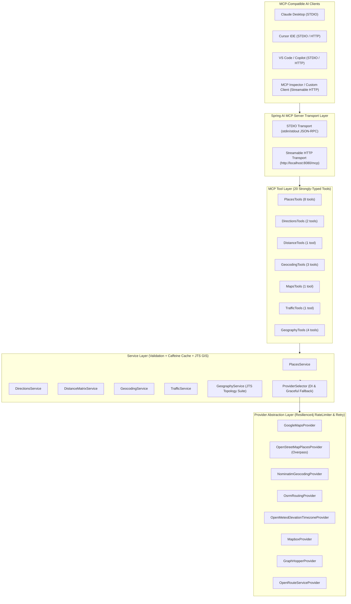

# Google Maps-Like MCP Server in Java

A production-ready, extensible **Model Context Protocol (MCP) Server** built entirely in **Java 21 LTS** and **Spring Boot 3.5.7** using the **Official Spring AI MCP Server SDK (`spring-ai-starter-mcp-server-webmvc`)** and **JTS Topology Suite 1.20.0**.

This server enables AI assistants—such as **Claude Desktop**, **Cursor**, **VS Code (GitHub Copilot / MCP extensions)**, **ChatGPT MCP integrations**, and **MCP Inspector**—to interact with geographical data, location discovery, nearby businesses, turn-by-turn navigation, distance matrices, geocoding, elevation, timezones, live traffic conditions, and GIS polygon analysis using natural language.

---

## Table of Contents

1. [Project Overview](#1-project-overview)
2. [Technology Stack](#2-technology-stack)
3. [Architecture](#3-architecture)
4. [List of All 20 MCP Tools](#4-list-of-all-20-mcp-tools)
5. [Provider Implementations](#5-provider-implementations)
6. [Project Structure](#6-project-structure)
7. [Prerequisites](#7-prerequisites)
8. [Installation Instructions](#8-installation-instructions)
9. [Configuration Using Environment Variables](#9-configuration-using-environment-variables)
10. [How to Run the Application](#10-how-to-run-the-application)
11. [MCP Inspector Configuration](#11-mcp-inspector-configuration)
12. [Example MCP Tool Calls](#12-example-mcp-tool-calls)
13. [Testing Instructions](#13-testing-instructions)
14. [Health Endpoint](#14-health-endpoint)
15. [Security Instructions](#15-security-instructions)
16. [Future Improvements](#16-future-improvements)

---

## 1. Project Overview

`maps-mcp-server-java` provides an intelligent, provider-independent geographical backend exposed over the **Model Context Protocol (MCP)**. It supports both **Streamable HTTP** (`http://localhost:8080/mcp`) and **STDIO** (`stdin`/`stdout` subprocess) transports out of the box.

Key capabilities include:
- **Zero-Key Out-of-the-Box Operation**: Defaults to the free OpenStreetMap ecosystem (`Nominatim`, `Overpass API`, `OSRM`, and `Open-Meteo`) so it works immediately without requiring paid API keys.
- **Multi-Provider Pluggability**: Seamlessly switch to **Google Maps Platform**, **Mapbox**, **GraphHopper**, or **OpenRouteService** via environment variables.
- **Strict Data Integrity**: Never fabricates business ratings, customer reviews, opening hours, or live traffic data. When a configured provider does not support a capability, the server returns an explicit `PROVIDER_CAPABILITY_UNSUPPORTED` response.

---

## 2. Technology Stack

| Component | Technology / Version |
| :--- | :--- |
| **Language** | Java 21 LTS |
| **Framework** | Spring Boot 3.5.7 (Spring WebMVC, Validation, Actuator, Cache) |
| **MCP SDK** | Spring AI 1.1.0 (`spring-ai-starter-mcp-server-webmvc`) & Official Java MCP SDK |
| **GIS Engine** | JTS Topology Suite 1.20.0 (`org.locationtech.jts:jts-core`) |
| **Build Tool** | Apache Maven 3.9+ |
| **Caching** | Spring Cache with Caffeine (configurable TTL & max entries) |
| **HTTP Client** | Spring `RestClient` backed by Apache HttpClient 5 connection pooling |
| **Resilience** | Resilience4j 2.3.0 (`@RateLimiter`, `@Retry` with exponential backoff, `@CircuitBreaker`) |
| **Logging** | SLF4J with Logback (`System.err` routing for STDIO protocol purity) |
| **Testing** | JUnit 5, Mockito, WireMock 3.10.0, Testcontainers, Spring Boot Test |

---

## 3. Architecture



---

## 4. List of All 20 MCP Tools

All 20 MCP tools are registered via [`McpConfig`](src/main/java/com/example/mapsmcp/config/McpConfig.java) and return a strongly-typed `McpToolResponse<T>` JSON envelope:

| # | Tool Name | Tool Class | Description | Required Parameters | Optional Parameters |
| :--- | :--- | :--- | :--- | :--- | :--- |
| 1 | `search_places` | `PlacesTools` | Search locations, addresses, landmarks, cities, and businesses by text query | `query` | `latitude`, `longitude`, `radiusMeters`, `category`, `openNow`, `minRating`, `limit` |
| 2 | `search_nearby` | `PlacesTools` | Search nearby points of interest around GPS coordinates within a radius | `latitude`, `longitude` | `radiusMeters`, `category`, `keyword`, `openNow`, `minRating`, `limit` |
| 3 | `get_place_details` | `PlacesTools` | Retrieve full place details (address, phone, website, hours, photos, reviews) | `placeId` | — |
| 4 | `get_directions` | `DirectionsTools` | Turn-by-turn navigation directions, distance, duration, and route geometry | `origin`, `destination` | `travelMode`, `waypoints`, `alternatives`, `avoidTolls`, `avoidHighways`, `avoidFerries` |
| 5 | `get_distance_matrix` | `DistanceTools` | Multi-origin to multi-destination travel distance and duration matrix | `origins`, `destinations` | `travelMode` |
| 6 | `geocode_address` | `GeocodingTools` | Forward geocode street address or place name to GPS coordinates | `address` | `countryCode`, `limit` |
| 7 | `reverse_geocode` | `GeocodingTools` | Reverse geocode GPS coordinates to a structured street address | `latitude`, `longitude` | — |
| 8 | `autocomplete_location` | `PlacesTools` | Provide location and address autocomplete suggestions for partial input | `input` | `latitude`, `longitude`, `radiusMeters`, `limit` |
| 9 | `get_place_photos` | `PlacesTools` | Retrieve verified photo metadata, attributions, and image URLs | `placeId` | `maxWidth` |
| 10 | `get_place_reviews` | `PlacesTools` | Retrieve authentic user reviews and star ratings when supported | `placeId` | — |
| 11 | `get_place_opening_hours` | `PlacesTools` | Retrieve opening hours schedule and current open/closed status | `placeId` | — |
| 12 | `get_map_data` | `MapsTools` | Compute slippy map tile URL (`z/x/y`), tile/viewport bounds, and GeoJSON | `latitude`, `longitude` | `zoomLevel` |
| 13 | `get_route_alternatives` | `DirectionsTools` | Compute and compare primary and alternative routes between two locations | `origin`, `destination` | `travelMode` |
| 14 | `get_timezone` | `GeographyTools` | Retrieve IANA timezone ID, UTC/DST offsets, and current local ISO time | `latitude`, `longitude` | `timestampSeconds` |
| 15 | `get_elevation` | `GeographyTools` | Retrieve terrain elevation in meters above sea level for GPS coordinates | `locations` | — |
| 16 | `get_traffic_conditions` | `TrafficTools` | Retrieve live traffic congestion, travel delays, and road warnings | *(either `latitude`+`longitude` or `origin`+`destination`)* | `radiusMeters` |
| 17 | `find_nearby_categories` | `PlacesTools` | Search multiple POI categories simultaneously around GPS coordinates | `latitude`, `longitude`, `categories` | `radiusMeters`, `limitPerCategory` |
| 18 | `calculate_area` | `GeographyTools` | Geodesic polygon area ($m^2$, $km^2$, hectares, acres), perimeter, centroid, and GeoJSON | `vertices` | — |
| 19 | `get_location_coordinates` | `GeocodingTools` | Convert a named location, landmark, or city directly into GPS coordinates | `locationName` | `countryCode` |
| 20 | `get_country_and_city_info` | `GeographyTools` | Administrative metadata, population, Wikidata ID, and boundary GeoJSON | `query` | `countryCode` |

---

## 5. Provider Implementations

The system implements a clean, interface-driven provider architecture (`MapProvider`, `PlacesProvider`, `GeocodingProvider`, `DirectionsProvider`, `DistanceMatrixProvider`, `TrafficProvider`, `ElevationProvider`, `MapTileProvider`) managed by [`ProviderSelector`](src/main/java/com/example/mapsmcp/providers/ProviderSelector.java):

| Provider | Implementation Class | Supported Capabilities |
| :--- | :--- | :--- |
| **Google Maps Platform** | `GoogleMapsProvider` | Places Search, Nearby Search, Place Details, Reviews, Photos, Opening Hours, Autocomplete, Forward/Reverse Geocoding, Directions, Route Alternatives, Distance Matrix, Elevation, TimeZone, Live Traffic Telemetry |
| **OpenStreetMap (Overpass & Tiles)** | `OpenStreetMapPlacesProvider` | Nearby POI Search, Category Search, Place Details, Opening Hours (`opening_hours` tag), Wikimedia/OSM Photos, Slippy Map Tiles (`{z}/{x}/{y}`) |
| **Nominatim (OSM)** | `NominatimGeocodingProvider` | Forward Geocoding, Reverse Geocoding, Location Autocomplete, Country/City Administrative & Boundary GeoJSON Info |
| **OSRM** | `OsrmRoutingProvider` | Driving, Walking, and Cycling Turn-by-Turn Directions, Alternative Routes, Multi-Point Distance & Duration Matrices |
| **Open-Meteo** | `OpenMeteoElevationTimezoneProvider` | DEM Terrain Elevation (90m resolution) and IANA Timezone Lookup |
| **Mapbox** | `MapboxProvider` | Forward/Reverse Geocoding, Driving/Walking/Cycling Directions, Map Tiles |
| **GraphHopper** | `GraphHopperProvider` | Driving, Walking, and Cycling Turn-by-Turn Routing |
| **OpenRouteService** | `OpenRouteServiceProvider` | Driving, Walking, and Cycling Turn-by-Turn Routing |

---

## 6. Project Structure

```text
maps-mcp-server-java/
├── pom.xml
├── README.md
├── .env.example
├── .gitignore
├── Dockerfile
├── docker-compose.yml
├── run-http.bat / run-http.sh
├── run-stdio.bat / run-stdio.sh
├── mcp-client-config/
│   ├── claude_desktop_config.json
│   ├── cursor_config.json
│   └── vscode_config.json
└── src/
    ├── main/
    │   ├── java/com/example/mapsmcp/
    │   │   ├── MapsMcpApplication.java
    │   │   ├── config/          # McpConfig, ProviderConfig, CacheConfig, HttpClientConfig, SecurityConfig, MapsProperties
    │   │   ├── constants/       # MapConstants
    │   │   ├── dto/             # request/ and response/ records
    │   │   ├── enums/           # ProviderType, TravelMode, PlaceCategory
    │   │   ├── exceptions/      # MapsMcpException, ProviderApiException, UnsupportedCapabilityException, ValidationException
    │   │   ├── mcp/
    │   │   │   ├── handlers/    # McpExecutionHandler
    │   │   │   └── tools/       # PlacesTools, DirectionsTools, DistanceTools, GeocodingTools, MapsTools, TrafficTools, GeographyTools
    │   │   ├── models/          # Strongly-typed domain records (Coordinates, PlaceDetails, RouteOption, GeocodeResult, etc.)
    │   │   ├── providers/       # Provider interfaces, ProviderSelector, google/, openstreetmap/, nominatim/, osrm/, mapbox/, graphhopper/, openrouteservice/
    │   │   ├── services/        # PlacesService, DirectionsService, DistanceMatrixService, GeocodingService, TrafficService, GeographyService
    │   │   ├── utils/           # GeoMathUtils (JTS GIS engine), SecretMasker
    │   │   └── validation/      # GeoValidator (coordinate & SSRF validation)
    │   └── resources/
    │       ├── application.yml
    │       ├── application-dev.yml
    │       ├── application-prod.yml
    │       └── logback-spring.xml
    └── test/
        └── java/com/example/mapsmcp/
            ├── integration/     # MapsMcpServerIntegrationTest, McpTransportProtocolTest
            ├── providers/       # ProviderWireMockIntegrationTest
            ├── services/        # ServiceCachingTest
            ├── tools/           # AllTwentyMcpToolsTest
            └── validation/      # GeoValidatorAndMathTest
```

---

## 7. Prerequisites

- **Java**: JDK **21 LTS** or later (`java -version`)
- **Maven**: Apache Maven **3.9+** (`mvn -version`)
- **Git**: Git 2.30+ (`git --version`)
- **Docker** *(Optional)*: Docker Engine 24+ and Docker Compose v2

---

## 8. Installation Instructions

1. Clone the repository:
   ```bash
   git clone https://github.com/Nayan76/maps-mcp-server-java.git
   cd maps-mcp-server-java
   ```
2. Build the project and package the executable JAR:
   ```bash
   mvn clean package -DskipTests
   ```
   This produces `target/google-maps-mcp-server.jar`.

---

## 9. Configuration Using Environment Variables

All credentials and provider settings are injected via environment variables and bound in [`application.yml`](src/main/resources/application.yml):

```yaml
maps:
  provider: ${MAP_PROVIDER:openstreetmap}
  google:
    api-key: ${GOOGLE_MAPS_API_KEY:}
  mapbox:
    access-token: ${MAPBOX_ACCESS_TOKEN:}
  graphhopper:
    api-key: ${GRAPHHOPPER_API_KEY:}
  openrouteservice:
    api-key: ${OPENROUTESERVICE_API_KEY:}
```

Copy `.env.example` to `.env` for local customization (`.env` is git-ignored):

```bash
cp .env.example .env
```

| Environment Variable | Default | Description |
| :--- | :--- | :--- |
| `SERVER_PORT` | `8080` | HTTP server port (`http` mode) |
| `MCP_TRANSPORT` | `http` / `stdio` | Transport mode (`http` for Streamable HTTP server, `stdio` for subprocess) |
| `MCP_HTTP_PROTOCOL` | `STREAMABLE` | `STREAMABLE`, `STATELESS`, or `SSE` |
| `MAP_PROVIDER` | `openstreetmap` | `openstreetmap`, `google`, `mapbox`, `graphhopper`, `openrouteservice` |
| `MAP_FALLBACK_ENABLED` | `true` | Automatically fall back to OpenStreetMap if primary provider key is unset |
| `GOOGLE_MAPS_API_KEY` | *(empty)* | Google Maps Platform API Key (optional) |
| `MAPBOX_ACCESS_TOKEN` | *(empty)* | Mapbox Access Token (optional) |
| `GRAPHHOPPER_API_KEY` | *(empty)* | GraphHopper API Key (optional) |
| `OPENROUTESERVICE_API_KEY` | *(empty)* | OpenRouteService API Key (optional) |
| `CACHE_ENABLED` | `true` | Enable Caffeine caching |
| `CACHE_TTL` | `3600` | Cache TTL in seconds |

---

## 10. How to Run the Application

### Mode 1: Streamable HTTP Transport (`http://localhost:8080/mcp`)

**Windows:**
```powershell
.\run-http.bat
```

**Linux / macOS:**
```bash
chmod +x run-http.sh
./run-http.sh
```

**Direct Maven / Java Command:**
```bash
java -jar target/google-maps-mcp-server.jar
```

Active Endpoints:
- **Application Base URL**: `http://localhost:8080`
- **MCP Streamable HTTP Endpoint**: `http://localhost:8080/mcp`
- **Health Endpoint**: `http://localhost:8080/actuator/health`

### Mode 2: STDIO Subprocess Transport (For Claude Desktop, Cursor, VS Code)

**Windows:**
```powershell
.\run-stdio.bat
```

**Linux / macOS:**
```bash
chmod +x run-stdio.sh
./run-stdio.sh
```

**Direct Java Command:**
```bash
java -Dspring.ai.mcp.server.stdio=true \
     -Dspring.main.web-application-type=none \
     -Dspring.main.banner-mode=off \
     -jar target/google-maps-mcp-server.jar
```

---

## 11. MCP Inspector Configuration

You can interactively test all 20 MCP tools using the official **MCP Inspector**:

1. Start the server in Streamable HTTP mode:
   ```powershell
   .\run-http.bat
   ```
2. Launch MCP Inspector:
   ```powershell
   npx @modelcontextprotocol/inspector
   ```
3. In the MCP Inspector web UI:
   - **Transport Type**: Select `Streamable HTTP`
   - **URL**: `http://localhost:8080/mcp`
   - Click **Connect**, then navigate to the **Tools** tab and click **List Tools** to inspect and execute all 20 tools.

*(Alternatively, choose `STDIO` transport in MCP Inspector with command `java` and arguments `-Dspring.ai.mcp.server.stdio=true -Dspring.main.web-application-type=none -Dspring.main.banner-mode=off -jar target/google-maps-mcp-server.jar`).*

---

## 12. Example MCP Tool Calls

### Example 1: `geocode_address`
**Request Arguments:**
```json
{
  "address": "Victoria Memorial, Kolkata",
  "countryCode": "IN",
  "limit": 1
}
```
**Response:**
```json
{
  "success": true,
  "toolName": "geocode_address",
  "provider": "OpenStreetMap Nominatim",
  "timestamp": "2026-11-08T13:00:00Z",
  "data": [
    {
      "placeId": "osm:way:554433",
      "formattedAddress": "Victoria Memorial, 1, Queens Way, Kolkata, West Bengal, 700071, India",
      "coordinates": {
        "latitude": 22.544808,
        "longitude": 88.342558
      },
      "addressDetails": {
        "formattedAddress": "Victoria Memorial, 1, Queens Way, Kolkata, West Bengal, 700071, India",
        "street": "Queens Way",
        "city": "Kolkata",
        "state": "West Bengal",
        "country": "India",
        "countryCode": "IN",
        "postalCode": "700071"
      },
      "locationType": "museum",
      "category": "tourism",
      "provider": "OpenStreetMap Nominatim"
    }
  ]
}
```

### Example 2: `get_directions`
**Request Arguments:**
```json
{
  "origin": "22.6547,88.4467",
  "destination": "22.5830,88.3426",
  "travelMode": "driving",
  "alternatives": true
}
```

### Example 3: `calculate_area`
**Request Arguments:**
```json
{
  "vertices": [
    { "latitude": 22.5440, "longitude": 88.3410 },
    { "latitude": 22.5440, "longitude": 88.3440 },
    { "latitude": 22.5465, "longitude": 88.3440 },
    { "latitude": 22.5465, "longitude": 88.3410 }
  ]
}
```

---

## 13. Testing Instructions

Run the complete automated test suite (41 unit, caching, WireMock provider, and end-to-end MCP transport tests):

```bash
mvn test
```

Test suites included:
- `AllTwentyMcpToolsTest`: Unit tests verifying all 20 MCP tools and structured error handling.
- `ProviderWireMockIntegrationTest`: WireMock HTTP integration tests for Nominatim, Overpass, OSRM, Google Maps Platform, and Open-Meteo (zero paid API calls required).
- `MapsMcpServerIntegrationTest`: Spring Boot context test verifying all 20 registered MCP tools, Caffeine caches, and Actuator health headers.
- `McpTransportProtocolTest`: Full protocol test using the official `McpSyncClient` over both **Streamable HTTP** (`http://localhost:<port>/mcp`) and **STDIO** subprocess transports.
- `GeoValidatorAndMathTest` & `ServiceCachingTest`: Validation, SSRF protection, secret masking, JTS polygon math, and cache verification.

---

## 14. Health Endpoint

When running in HTTP mode, Spring Boot Actuator exposes health, info, metrics, and cache statistics:

- **Health Check**: `GET http://localhost:8080/actuator/health`
  ```json
  {
    "status": "UP",
    "components": {
      "diskSpace": { "status": "UP" },
      "ping": { "status": "UP" },
      "ssl": { "status": "UP" }
    }
  }
  ```
- **Metrics**: `GET http://localhost:8080/actuator/metrics`
- **Caches**: `GET http://localhost:8080/actuator/caches`

---

## 15. Security Instructions

1. **Never Hardcode or Commit API Keys**: Always pass `GOOGLE_MAPS_API_KEY`, `MAPBOX_ACCESS_TOKEN`, `GRAPHHOPPER_API_KEY`, and `OPENROUTESERVICE_API_KEY` via environment variables or untracked `.env` files.
2. **Automatic Secret Redaction**: [`SecretMasker`](src/main/java/com/example/mapsmcp/utils/SecretMasker.java) automatically masks `key`, `api_key`, `access_token`, and `token` query parameters in logs and error messages.
3. **SSRF Protection**: [`GeoValidator`](src/main/java/com/example/mapsmcp/validation/GeoValidator.java) validates all configured provider base URLs at startup and blocks private/loopback network addresses in production (`maps.allow-localhost-urls=false`).
4. **Request Limits & Headers**: [`SecurityConfig`](src/main/java/com/example/mapsmcp/config/SecurityConfig.java) enforces a 2 MB maximum payload limit and sets `X-Content-Type-Options: nosniff`, `X-Frame-Options: DENY`, and `Cache-Control: no-store`.

---

## 16. Future Improvements

- Optional Redis distributed cache profile for multi-instance Kubernetes deployments.
- Isochrone (reachability polygon) calculation tool using OpenRouteService / Mapbox Isochrone APIs.
- GTFS real-time public transit feed integration for open-source transit schedules.
- OAuth2 / Bearer token authentication filter for public internet-facing Streamable HTTP deployments.
